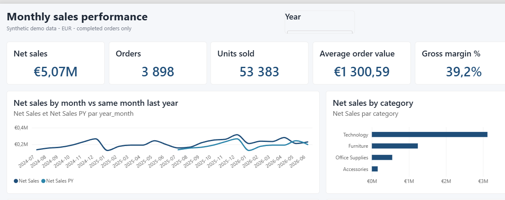
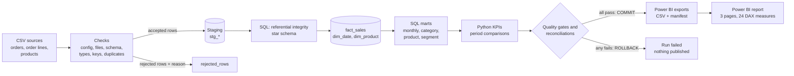
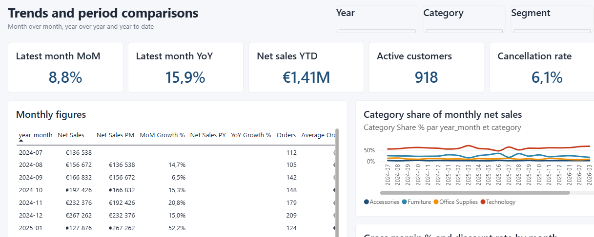
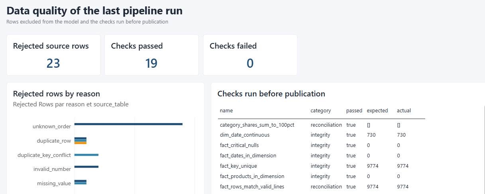

# Python Reporting Pipeline

A reproducible, tested **sales reporting pipeline**: CSV sources → quality checks → staging → SQL star
schema (SQLite or PostgreSQL) → KPIs → verified exports → **Power BI dashboard**.

> Portfolio project (service 3 of 3), built on synthetic data. Verified on **Windows 11, Python 3.14.7,
> SQLite 3.50, PostgreSQL 18.6 and Power BI Desktop 2.157 (August 2026)** only. See
> [known limitations](#known-limitations).



*The report opened in Power BI Desktop after a refresh on the demo data (real screenshot, cropped;
chart subtitles follow the Windows language of the machine).*

## The business problem

A sales team wants a monthly view of its performance: revenue and its trend, the categories and
products that drive it, the customer segments, month-over-month and year-over-year changes — and,
before anyone trusts those numbers, **proof that the data behind them is complete and consistent**.

Spreadsheet exports do not give that proof: rows get duplicated, references break, dates are invalid,
and a join can silently multiply revenue. This project builds the whole chain so that every figure in
the dashboard can be traced back to its source rows, and every excluded row is counted and explained.

## What the pipeline does



| Step | Implemented in | What happens |
| --- | --- | --- |
| Configuration | Python (`config.py`) | TOML validated strictly: unknown keys, paths outside the project, credentials in the file are refused |
| Ingestion | Python (`sources.py`) | Typed parsing of each row; normalization of labels; rejection with a reason code; exact duplicates vs conflicting keys |
| Staging and model | SQL (`sql/10_schema.sql`, `30_model.sql`) | Staging tables, star schema with keys and constraints, one fact row per order line |
| Integrity | SQL (`sql/20_integrity.sql`) | Lines of unknown orders or products are rejected and recorded |
| Calendar, KPIs | Python (`transform.py`) | Date dimension; KPI and period comparisons with exact decimals |
| Marts | SQL (`sql/40_marts.sql`) | Monthly sales with previous month / previous year, category shares, product rankings (window functions), segments |
| Controls | Python + SQL (`quality.py`) | 3 quality gates and 16 integrity, reconciliation and information checks, including an independent Python recomputation of revenue |
| Publication | Python (`exports.py`) | CSV files for Power BI written aside, read back, verified, then swapped in atomically |
| Reporting | Python (`reporting.py`, `log.py`) | `run_report.json`, `quality_report.md`, `rejected_rows.csv`, structured JSON-lines log |

The SQL is real and executed: the same files run unchanged on SQLite and PostgreSQL, and **both engines
produce byte-identical exports** (tested).

## Features

- **Two warehouses, one SQL code base**: SQLite (default, no server) or PostgreSQL (psycopg; credentials
  only from an environment variable). Amounts are integer cents and rates basis points, so totals are
  exact on both engines.
- **Nothing is dropped silently**: every excluded row is stored with its file, line, reason and values
  (`missing_value`, `invalid_date`, `invalid_number`, `out_of_range`, `invalid_value`, `malformed_row`,
  `duplicate_row`, `duplicate_key_conflict`, `unknown_order`, `unknown_product`).
- **Transactional runs**: the model is rebuilt inside one transaction; any failure rolls back and the
  previous model and exports stay as they were. Re-running gives identical results, without duplicates.
- **Quality gates**: a run fails (and publishes nothing) if a source has more rejected rows than its
  configured threshold, or if any reconciliation check fails.
- **Safe by default**: paths confined to the project root, parameterized SQL, refusal to modify a
  database or schema the pipeline did not create, redacted connection errors, a run lock.
- **Power BI**: a PBIP project (TMDL semantic model + PBIR report) generated from one specification,
  opened, refreshed and checked in Power BI Desktop; DAX results compared with the pipeline: 174 values,
  0 differences.

## Technologies

| Area | Technology |
| --- | --- |
| Language | Python 3.14 (standard library only for the SQLite pipeline: `csv`, `decimal`, `sqlite3`, `tomllib`) |
| SQL engines | SQLite 3.50 (embedded), PostgreSQL 18 (optional, via psycopg 3) |
| Reporting | Power BI Desktop (PBIP: TMDL + PBIR), DAX, Power Query M |
| Quality | pytest (test suite incl. real PostgreSQL), Ruff (lint + format) |

pandas is not used: the volumes (thousands to a few hundred thousand rows) are handled by the CSV
module and the SQL engine, and exact decimal arithmetic matters more than vectorization here
([decision record](docs/decisions/0001-sqlite-default-postgres-optional.md)).

## Requirements and installation

Python 3.14 (the only version tested). From the project folder, in PowerShell:

```powershell
python -m venv .venv
.venv\Scripts\python.exe -m pip install -e ".[dev]" -c constraints.txt
```

The pipeline itself has **no third-party dependency**. `[dev]` adds pytest, Ruff and psycopg;
`[postgres]` adds psycopg only (`pip install ".[postgres]"`). PostgreSQL itself is needed only for the
PostgreSQL mode; Power BI Desktop only for the dashboard.

## Usage

```bash
reporting-pipeline check --config config/pipeline.toml
```

```bash
reporting-pipeline run --config config/pipeline.toml
```

```bash
python scripts/demo.py
```

`check` reads the sources without writing anything; `run` executes the whole pipeline; `demo.py`
chains check, run and the independent verification. `generate-demo-data --output data/sample
--overwrite` regenerates the synthetic data set (deterministic).

| Exit code | Meaning |
| --- | --- |
| 0 | Success (`success` or `success_with_rejections`): exports published |
| 1 | The run failed: nothing committed or published; the report says why |
| 2 | Invalid command line |
| 3 | Refused before running: invalid configuration, unusable sources, another run holds the lock |

### Configuration

```toml
[project]
name = "monthly-sales-reporting"
root = ".."                         # every path below is relative to the project folder

[sources]
directory = "data/sample"
[sources.files]
orders = "orders.csv"
order_lines = "order_lines.csv"
products = "products.csv"

[warehouse]
engine = "sqlite"                   # or "postgres" with connection_env = "REPORTING_PG_DSN"
sqlite_path = "output/warehouse.sqlite"

[outputs]
powerbi_dir = "output/powerbi"
runs_dir = "runs"

[quality]
max_rejected_rate = { orders = 0.01, order_lines = 0.01, products = 0.05 }
```

Full reference and the PostgreSQL mode: [docs/usage.md](docs/usage.md).

## Results observed on the demo data

Synthetic data: 24 months (July 2024 – June 2026), 4,159 order rows, 9,790 order-line rows, 29 product
rows, with **15 planted anomalies** ([data quality](docs/data-quality.md)). One run (SQLite) gives:

| Measure | Value |
| --- | --- |
| Rows rejected | 23 (orders 6, order lines 16, products 1), each with its reason; 2 values normalized |
| Model | fact_sales 9,774 rows (= 9,790 − 16), dim_product 28, dim_date 730 days |
| Checks | 19 passed, 0 failed (3 gates, 16 integrity, reconciliation and information checks) |
| Net sales | €5,069,715.72 — 3,898 orders, 53,383 units, 918 active customers |
| Average order value / gross margin | €1,300.59 / €1,987,329.32 (39.20 %) |
| Latest month (June 2026) | €230,101.95: +8.77 % vs May 2026, +15.87 % vs June 2025 |
| Last 12 vs prior 12 months | €2,785,629.92, +21.96 % |
| Category mix | Technology 61.5 %, Furniture 24.5 %, Office Supplies 10.9 %, Accessories 3.1 % |
| Top products | Laptop 16in €1,189,828.25, Laptop 14in €982,610.20, Standing Desk €385,601.20 |
| Duration | under 1 s on SQLite, about 2 s on the local PostgreSQL |

These values are verified three ways: **SQL reconciliation checks** inside the run, an **independent
recomputation from the raw CSV files** that does not import the package (68 values, 0 differences),
and **DAX in Power BI** (174 values, 0 differences). Details: [docs/demo.md](docs/demo.md),
[docs/kpis.md](docs/kpis.md). The run reports of the demo are committed in
[reports/examples/](reports/examples/README.md).

## Power BI

The [powerbi/](powerbi/README.md) folder contains a **Power BI project (PBIP)** with:

- a semantic model in TMDL: star schema (Sales, Calendar marked as date table, Product, plus quality
  tables), relationships, 24 DAX measures (net sales, orders, AOV, margin %, previous month,
  same period last year, YTD, category share, product rank, data-quality counts);
- a 3-page report in PBIR: **Overview**, **Trends and comparisons**, **Data quality**, with year,
  category and segment slicers;
- `measures.dax`, the theme, and the validation tools used to compare DAX with the pipeline.

What was really done in this environment: the project was opened in Power BI Desktop 2.157, refreshed
from the exported CSV files, its DAX measures queried through the local engine and compared with the
pipeline exports (174 values, 0 differences), and the pages were captured. **Not done:** no `.pbix` file
was saved and nothing was published to the Power BI service. To open it yourself, set the `DataFolder`
parameter to your export folder ([powerbi/README.md](powerbi/README.md)).

| Trends and comparisons | Data quality |
| --- | --- |
|  |  |

## Tests and quality checks

```powershell
.venv\Scripts\python.exe -m pytest -q
.venv\Scripts\python.exe -m ruff check src tests scripts
.venv\Scripts\python.exe -m ruff format --check src tests scripts
```

The suite covers the configuration, every parser and rejection reason, the transformations (values
computed by hand), full runs and reruns, every failure path (quality gate, SQL error in the middle of
the build, export failure, foreign database, lock, missing file, unexpected error), the CLI, the Power BI
project, and **PostgreSQL on a real temporary server** started by the tests (`initdb`, skipped if the
PostgreSQL binaries are absent). See [docs/testing.md](docs/testing.md).

## Documentation

| Document | Content |
| --- | --- |
| [Architecture](docs/architecture.md) | Components, flow, run lifecycle, failure behaviour |
| [Data model](docs/data-model.md) | Sources, star schema, grain, keys, types, export format |
| [Transformations](docs/transformations.md) | Python and SQL steps, business rules |
| [KPIs](docs/kpis.md) | Definitions, formulas, observed values |
| [Data quality](docs/data-quality.md) | Checks, reason codes, planted anomalies, thresholds |
| [Usage](docs/usage.md) | Commands, configuration, PostgreSQL mode, troubleshooting |
| [Demo](docs/demo.md) | End-to-end walkthrough from a clean clone, with real outputs |
| [Testing](docs/testing.md) | What is tested and how |
| [Decisions](docs/decisions/README.md) | Architecture decision records |

## Project structure

```text
src/reporting_pipeline/   package: cli, config, sources, warehouse, transform, quality, exports,
                          reporting, pipeline, demo_data, sql/ (the executed SQL files)
config/                   demo configuration (SQLite) and PostgreSQL example (no secret)
data/sample/              synthetic demo data (deterministic, regenerable)
powerbi/                  PBIP project, measures.dax, theme, validation tools
reports/examples/         committed outputs of a real demo run
scripts/                  demo, independent verifier, PostgreSQL demo server, Power BI generator
tests/                    pytest suite
docs/                     documentation, diagrams, screenshots, decision records
```

The SQL lives in `src/reporting_pipeline/sql/` so that a regular (non-editable) installation still
finds it ([decision](docs/decisions/0002-portable-sql-integer-money.md)).

## Known limitations

- Verified only on Windows 11 with Python 3.14.7; Linux and macOS are untested.
- PostgreSQL tested with 18.6 on a local disposable server; managed/cloud PostgreSQL untested.
- The Power BI project was validated in Power BI Desktop 2.157 (August 2026); older Desktop versions may
  not open PBIR/TMDL projects. No `.pbix` is committed; Power BI Service publishing and scheduled refresh
  are not covered. The data folder parameter must be set by hand.
- Data is processed in memory by the CSV reader (fine for the demo volume; not benchmarked beyond it).
- Full rebuild on every run (no incremental loads); no scheduler, no API or database sources.
- Customer data is a synthetic identifier and segment only (no customer dimension).

More in [docs/architecture.md](docs/architecture.md#limitations-and-possible-improvements).

## Possible improvements

Incremental loading by period, a customer dimension, a PostgreSQL source connector, CI on Linux, a
benchmark on larger volumes, publication of the semantic model to the Power BI service.

## License

[MIT](LICENSE) — Copyright (c) 2026 LUMU BAMANA MANASSE.
