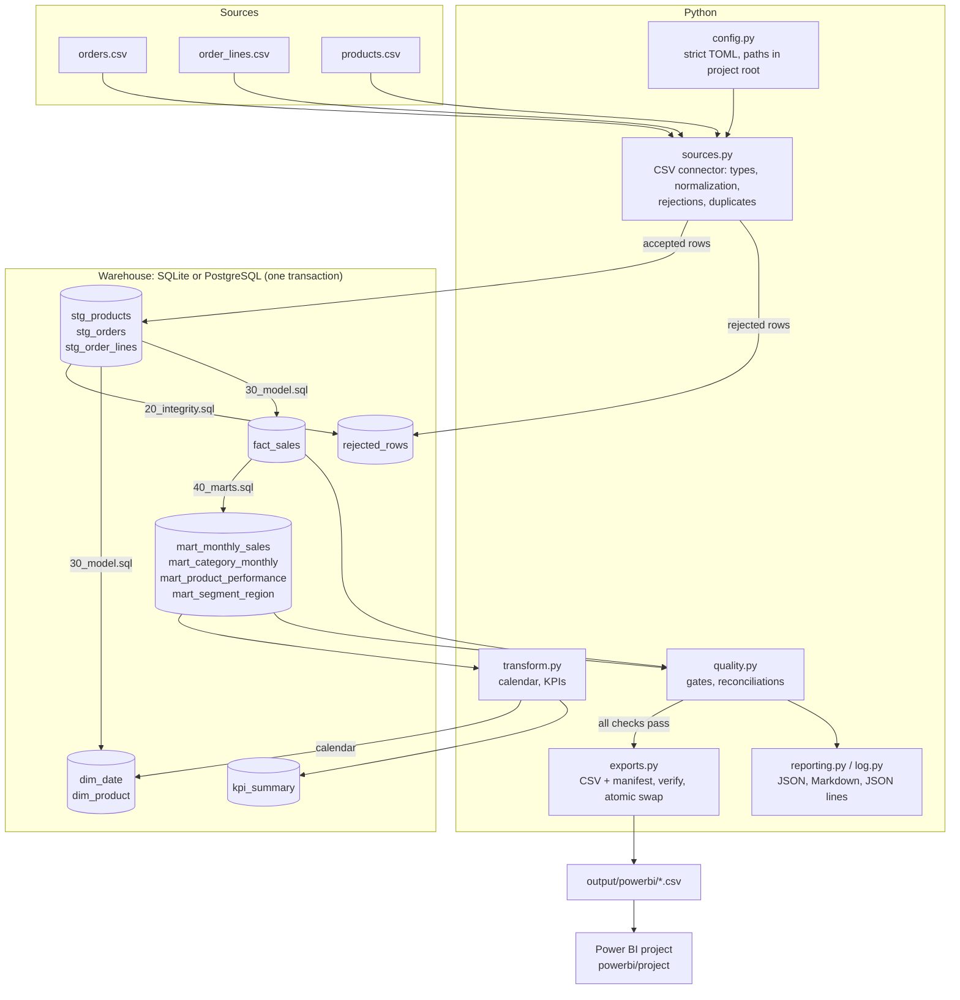

# Architecture

A small batch pipeline, run from the command line or a scheduler, that turns three CSV extracts into a
star schema, reporting tables, KPIs and files for Power BI. One process, one database, no services.

## Data flow

## Components

| Module | Responsibility |
| --- | --- |
| `cli.py` | Commands `check`, `run`, `generate-demo-data`; exit codes; console summary |
| `config.py` | Loads and validates the TOML configuration; resolves every path inside the project root |
| `sources.py` | CSV connector: file checks (existence, size, header), typed parsing per column, label normalization, rejection reasons, duplicate resolution |
| `warehouse.py` | SQLite and PostgreSQL connectors behind one interface; SQL file loading; ownership marker; transactions; parameterized inserts; redaction of driver messages |
| `sql/*.sql` | Staging and star schema DDL, referential-integrity rejections, model load, marts — executed as is on both engines |
| `transform.py` | Calendar dimension, the reference net-amount rule, KPI derivation with exact decimals |
| `quality.py` | Quality gates on rejected rows, reconciliation and integrity checks |
| `exports.py` | Power BI CSV files and manifest; read-back verification; atomic folder replacement |
| `reporting.py`, `log.py` | Markdown run report; JSON-lines event log |
| `pipeline.py` | Orchestration: lock, steps, transaction, statuses, reports, run history |
| `demo_data.py` | Deterministic synthetic data generator with planted anomalies |

The CSV connector and the warehouse connectors are independent: the first only reads files and returns
typed rows and rejections; the second only talks to a database. A different source (for example a
PostgreSQL source connector) would plug in at the same place as `sources.py`.

## Run lifecycle

1. **Lock**: `runs/.lock` is created exclusively; a second run is refused (exit 3).
2. **Read sources** (`read_orders`, `read_order_lines`, `read_products`): typed rows and rejections.
3. **Connect**: the warehouse must be new or carry the pipeline's ownership marker (`rp_metadata`).
4. **Build, in one transaction**: drop and recreate staging and model tables, load staging, record
   rejected rows, apply referential integrity, load the calendar, the dimensions and the fact table,
   build the marts, run the quality checks, compute and store the KPIs.
5. **Commit** if every check passed; otherwise **roll back** (the previous model is intact).
6. **Export** the Power BI files (written to a temporary folder, read back, then swapped in).
7. **Report**: `runs/<timestamp>_<run id>/` with `run_report.json`, `quality_report.md`,
   `rejected_rows.csv`, `pipeline.log.jsonl`; a row is added to `rp_runs` (run history).

| Situation | Behaviour |
| --- | --- |
| Rerun with the same sources | Same model, byte-identical exports (only the manifest's run id and time change); `rp_runs` grows by one row |
| A source file is missing or unreadable | `check` exits 3; `run` fails with a report (exit 1); nothing written to the model |
| Too many rejected rows | Quality gate fails: rollback, exit 1, previous exports kept |
| A reconciliation check fails | Rollback, exit 1 |
| SQL error during the build | Rollback, exit 1, the error (without credentials) in the report |
| Export or verification fails after commit | Exit 1; the previous export folder is kept, so the model is newer than the exports until the next successful run |
| The target database was not created by the pipeline | Refused before any change (exit 1) |
| Unexpected Python error | Recorded with its traceback in the log, status `failed`, never hidden |

Partial runs do not exist: either the whole model is committed or nothing is. There is no automatic
retry: a scheduler simply runs the command again.

## Why these choices

| Decision | Record |
| --- | --- |
| SQLite by default, PostgreSQL optional, no pandas | [0001](decisions/0001-sqlite-default-postgres-optional.md) |
| One portable SQL code base, money as integer cents | [0002](decisions/0002-portable-sql-integer-money.md) |
| Full rebuild in one transaction (idempotent reruns) | [0003](decisions/0003-full-rebuild-in-one-transaction.md) |
| Power BI as a text-based PBIP project generated from code | [0004](decisions/0004-powerbi-pbip-project.md) |

## Limitations and possible improvements

- **Full rebuild**: every run reloads all sources. Simple and idempotent, but not suited to very large
  histories; an incremental load by period would be the next step.
- **In-memory reading**: the CSV connector keeps the accepted rows in memory before loading them
  (about 14,000 rows in the demo). Larger volumes would need batched inserts or a bulk-load path
  (`COPY` on PostgreSQL); this was not benchmarked.
- **One source type**: CSV files. A PostgreSQL or API source connector is not implemented.
- **Platforms**: verified on Windows 11 only (Python 3.14.7, SQLite 3.50, PostgreSQL 18.6).
- **Power BI**: the project is opened and validated in Power BI Desktop; publishing to the Power BI
  service, gateways and scheduled refresh are out of scope.
