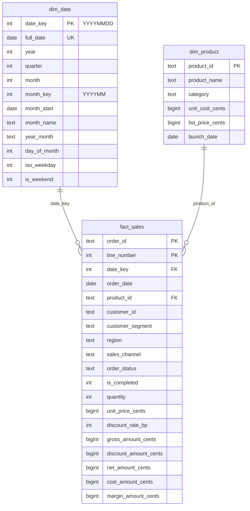

# Data model

## Sources (CSV, UTF-8, comma, one header row)

### `orders.csv` — one row per order (key: `order_id`)

| Column | Type | Rule |
| --- | --- | --- |
| `order_id` | text | required, unique |
| `order_date` | date | `YYYY-MM-DD`, a real calendar date |
| `customer_id` | text | required (pseudonymous synthetic id) |
| `customer_segment` | text | `Consumer`, `Small Business`, `Corporate` (case-insensitive, normalized) |
| `region` | text | `North`, `South`, `East`, `West` |
| `sales_channel` | text | `Online`, `Store`, `Partner` |
| `order_status` | text | `completed` or `cancelled` |

### `order_lines.csv` — one row per order line (key: `order_id` + `line_number`)

| Column | Type | Rule |
| --- | --- | --- |
| `order_id` | text | must be an accepted order |
| `line_number` | integer | 1 to 1000 |
| `product_id` | text | must exist in the product catalog |
| `quantity` | integer | 1 to 100,000 |
| `unit_price` | amount | `1234.56` (point, at most 2 decimals, no symbol), not negative |
| `discount_rate` | rate | `0.15` = 15 %, between 0 and 1, at most 4 decimals |

### `products.csv` — product catalog (key: `product_id`)

| Column | Type | Rule |
| --- | --- | --- |
| `product_id` | text | required, unique |
| `product_name`, `category` | text | required |
| `unit_cost`, `list_price` | amount | as above |
| `launch_date` | date | `YYYY-MM-DD` |

Extra columns are ignored with a warning; a missing required column stops the run. Business
assumptions of the synthetic data: amounts in EUR; the catalog unit cost is the current cost and is
applied to every sale (no cost history); a customer is identified only by an id and a segment.

## Star schema

- **Grain of `fact_sales`: one row per order line** (`order_id`, `line_number`), the finest level
  available. Order-level attributes (segment, region, channel, status) are carried as degenerate
  dimensions: they have few values and no attributes of their own, so a separate dimension would add a
  join without information.
- **Category** is an attribute of `dim_product` (a snowflaked category table would have one column).
- **`dim_date`** covers every day of every month present in the orders (730 days for the demo), so
  time-intelligence functions in Power BI have a contiguous calendar.
- Cancelled orders stay in the fact table (`is_completed = 0`) so that cancellations can be counted;
  every revenue figure filters `is_completed = 1`.

Constraints: primary keys on every table, foreign keys from `fact_sales` to both dimensions (enforced
by PostgreSQL and by SQLite with `PRAGMA foreign_keys = ON`), `CHECK` constraints on quantities,
discounts, statuses and flags in staging and the fact table.

## Reporting tables (marts)

| Table | Grain | Main columns |
| --- | --- | --- |
| `mart_monthly_sales` | month | orders, cancelled orders, active customers, units, gross/discount/net sales, cost, margin, previous month and same month last year |
| `mart_category_monthly` | month × category | orders, units, net sales, margin, share of the month |
| `mart_product_performance` | product (sold or not) | orders, units, net sales, margin, margin rate, overall rank, rank in category |
| `mart_segment_region` | segment × region | orders, customers, units, net sales, margin |
| `kpi_summary` | KPI | value, unit, period, definition ([KPIs](kpis.md)) |
| `rejected_rows` | rejected source row | source table, line, reason, column, message |
| `rp_runs` | run | run id, times, status, fact rows, rejected rows, error message (kept across runs) |

## Power BI export format

One CSV per table in `output/powerbi/` (UTF-8 without BOM, comma, LF, one header row, sorted by key, so
reruns give identical files), plus `quality_checks.csv` and `manifest.json` (run id, source file
hashes, row count and SHA-256 of every file):

- `*_cents` columns are exported as decimal amounts without the suffix (`net_amount_cents` 20825 →
  `net_amount` 208.25);
- `*_bp` columns as ratios with 4 decimals without the suffix (`discount_rate_bp` 1500 →
  `discount_rate` 0.1500);
- dates as `YYYY-MM-DD`; missing values as empty fields.

The Power BI model reads these files with an explicit UTF-8 encoding and `en-US` number parsing, so the
import does not depend on the regional settings of the computer.
